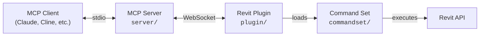

[](https://github.com/mcp-servers-for-revit/mcp-servers-for-revit)

# mcp-servers-for-revit

**Connect AI assistants to Autodesk Revit via the Model Context Protocol.**

mcp-servers-for-revit enables AI clients like Claude, Cline, and other MCP-compatible tools to read, create, modify, and delete elements in Revit projects. It consists of three components: a TypeScript MCP server that exposes tools to AI, a C# Revit add-in that bridges commands into Revit, and a command set that implements the actual Revit API operations.

> [!NOTE]
> This is a fork of the original [revit-mcp](https://github.com/mcp-servers-for-revit/revit-mcp) project with additional tools and functionality improvements.

> [!TIP]
> **🇲🇽 Este fork es mantenido por [Solken](https://solkenbim.com)**, un agente de IA para gestión de obra que cruza datos de Revit, OPUS/Neodata, MS Project y Power BI. Este MCP de Revit es el mismo componente de lectura que usa Solken internamente — lo publicamos gratis y de código abierto (MIT, misma licencia del proyecto original) para que lo pruebes con tu propio cliente MCP. Si te sirve y quieres el resto del flujo (presupuesto, cronograma, alertas, reportes), el plan Free de Solken Agent no cuesta nada: [solkenbim.com/servicios.html](https://solkenbim.com/servicios.html).
>
> Cambios de este fork respecto al original: nueva herramienta `get_element_by_id` (lee un elemento por ElementId sin requerir que esté seleccionado en la UI de Revit).

## Architecture



The **MCP Server** (TypeScript) translates tool calls from AI clients into WebSocket messages. The **Revit Plugin** (C#) runs inside Revit, listens for those messages, and dispatches them to the **Command Set** (C#), which executes the actual Revit API operations and returns results back up the chain.

## Requirements

- **Node.js 18+** (for the MCP server)
- **Autodesk Revit 2020 - 2027** (any supported version — 2027 is covered ahead of its official Autodesk release via a compatibility shim, see [Supported Revit Versions](#supported-revit-versions))

## Quick Start (Using a Release)

1. Download the ZIP for your Revit version from the [Releases](https://github.com/mcp-servers-for-revit/mcp-servers-for-revit/releases) page (e.g., `mcp-servers-for-revit-v1.0.0-Revit2025.zip`)

2. Extract the ZIP and copy the contents to your Revit addins folder:
   ```
   %AppData%\Autodesk\Revit\Addins\<your Revit version>\
   ```
   After copying you should have:
   ```
   Addins/2025/
   ├── mcp-servers-for-revit.addin
   └── revit_mcp_plugin/
       ├── RevitMCPPlugin.dll
       ├── ...
       └── Commands/
           └── RevitMCPCommandSet/
               ├── command.json
               └── 2025/
                   ├── RevitMCPCommandSet.dll
                   └── ...
   ```

3. Configure the MCP server in your AI client (see [MCP Server Setup](#mcp-server-setup))

4. Start Revit — if prompted about an unknown add-in, click **Always Load**

5. In Revit, click the **Settings** button on the mcp-servers-for-revit ribbon tab, enable the commands you want to use, and click **Save**

> [!WARNING]
> **Step 5 is not optional and must be repeated after every update.** The plugin decides which commands respond at runtime from `Commands/RevitMCPCommandSet/commandRegistry.json` — a file that records which commands *you* enabled through the Settings screen, separate from `command.json` (the manifest of what's *available*, deployed by every build). If `commandRegistry.json` doesn't exist yet, the plugin silently creates it empty, and every tool call fails with `Method '<name>' not found` — including tools that worked before, because the registry wasn't touched by the new build. If you ever see that error after updating, re-open **Settings → Select All → Save** before troubleshooting anything else.

## MCP Server Setup

The MCP server is published as an npm package and can be run directly with `npx`.

**Claude Code**

Run this in a **terminal** (not inside Claude Code):

```bash
claude mcp add mcp-server-for-revit -- cmd /c npx -y mcp-server-for-revit
```

**Claude Desktop**

Claude Desktop → Settings → Developer → Edit Config → `claude_desktop_config.json`:

```json
{
    "mcpServers": {
        "mcp-server-for-revit": {
            "command": "cmd",
            "args": ["/c", "npx", "-y", "mcp-server-for-revit"]
        }
    }
}
```

> [!TIP]
> **If you're developing this fork locally (not just using a published release), point `command` straight at `node` and `server/build/index.js` instead of a package name:**
> ```json
> {
>     "mcpServers": {
>         "mcp-server-for-revit": {
>             "command": "node",
>             "args": ["C:\\path\\to\\mcp-servers-for-revit\\server\\build\\index.js"]
>         }
>     }
> }
> ```
> `npx -y <package-name>` or a bare command name resolves through whatever's on `PATH` — a global install (`npm install -g`) or an `npm link`, either of which goes stale the moment you run `npm run build` locally and don't also reinstall/relink. Pointing directly at the built file means every local build is picked up on the next Claude Desktop restart, with nothing else to remember.

Restart Claude Desktop. When you see the hammer icon, the MCP server is connected.


## Revit Plugin Setup

If using a release ZIP, the plugin is already included. For manual installation:

1. Build the plugin from `plugin/` (see [Development](#development))
2. Copy `mcp-servers-for-revit.addin` to `%AppData%\Autodesk\Revit\Addins\<version>\`
3. Copy the `revit_mcp_plugin/` folder to the same addins directory

## Command Set Setup

If using a release ZIP, the command set is pre-installed inside the plugin. For manual installation:

1. Build the command set from `commandset/` (see [Development](#development))
2. Inside the plugin's installation directory, create `Commands/RevitMCPCommandSet/<year>/`
3. Copy the built DLLs into that folder
4. Copy `command.json` (from repo root) into `Commands/RevitMCPCommandSet/`

## Supported Tools

| Tool | Description |
| ---- | ----------- |
| `get_current_view_info` | Get current active view info |
| `get_current_view_elements` | Get elements from the current active view |
| `get_available_family_types` | Get available family types in current project |
| `get_selected_elements` | Get currently selected elements |
| `get_material_quantities` | Calculate material quantities and takeoffs |
| `ai_element_filter` | Intelligent element querying tool for AI assistants |
| `analyze_model_statistics` | Analyze model complexity with element counts |
| `create_point_based_element` | Create point-based elements (door, window, furniture) |
| `create_line_based_element` | Create line-based elements (wall, beam, pipe) |
| `create_surface_based_element` | Create surface-based elements (floor, ceiling, roof) |
| `create_grid` | Create a grid system with smart spacing generation |
| `create_level` | Create levels at specified elevations |
| `create_room` | Create and place rooms at specified locations |
| `create_dimensions` | Create dimension annotations in the current view |
| `create_structural_framing_system` | Create a structural beam framing system |
| `delete_element` | Delete elements by ID |
| `operate_element` | Operate on elements (select, setColor, hide, etc.) |
| `color_elements` | Color elements based on a parameter value |
| `tag_all_walls` | Tag all walls in the current view |
| `tag_all_rooms` | Tag all rooms in the current view |
| `export_room_data` | Export all room data from the project |
| `store_project_data` | Store project metadata in local database |
| `store_room_data` | Store room metadata in local database |
| `query_stored_data` | Query stored project and room data |
| `send_code_to_revit` | Send C# code to Revit to execute |
| `say_hello` | Display a greeting dialog in Revit (connection test) |
| `get_element_by_id` | Read every instance and type parameter of an element by its `ElementId`, without requiring it to be selected in the Revit UI |
| `get_project_views` | List all views in the current project |
| `get_rebar_host_data` | Get rebar quantities and host-element data for reinforcement takeoffs |
| `get_schedule_data` | Read rows and columns from an existing Revit schedule |

> [!IMPORTANT]
> After pulling a build with new tools (or installing a release ZIP for the first time), Revit does **not** pick them up automatically. Open the **Settings** button on the ribbon tab, re-select the commands you want enabled (or **Select All**), and click **Save** — see [Command Set Setup](#command-set-setup) and the troubleshooting note below.

## Testing

The test project uses [Nice3point.TUnit.Revit](https://github.com/Nice3point/RevitUnit) to run integration tests against a live Revit instance. No separate addin installation is required — the framework injects into the running Revit process automatically.

### Prerequisites

- **.NET 10 SDK** — required by Nice3point.Revit.Sdk 6.1.0. Install via `winget install Microsoft.DotNet.SDK.10`
- **Autodesk Revit 2026** (or 2025) — must be installed and licensed on your machine

### Running Tests

1. Open Revit 2026 (or 2025) and wait for it to fully load
2. Run the tests from the command line:

```bash
# For Revit 2026
dotnet test -c Debug.R26 -r win-x64 tests/commandset

# For Revit 2025
dotnet test -c Debug.R25 -r win-x64 tests/commandset
```

> **Note:** The `-r win-x64` flag is required on ARM64 machines because the Revit API assemblies are x64-only.

Alternatively, you can use `dotnet run`:

```bash
cd tests/commandset
dotnet run -c Debug.R26
```

### IDE Support

- **JetBrains Rider** — enable "Testing Platform support" in Settings > Build, Execution, Deployment > Unit Testing > Testing Platform
- **Visual Studio** — tests should be discoverable through the standard Test Explorer

### Test Structure

| Directory | Purpose |
|-----------|---------|
| `tests/commandset/AssemblyInfo.cs` | Global `[assembly: TestExecutor<RevitThreadExecutor>]` registration |
| `tests/commandset/Architecture/` | Tests for level and room creation commands |
| `tests/commandset/DataExtraction/` | Tests for model statistics, room data export, and material quantities |
| `tests/commandset/ColorSplashTests.cs` | Tests for color override functionality |
| `tests/commandset/TagRoomsTests.cs` | Tests for room tagging functionality |

### Writing New Tests

Test classes inherit from `RevitApiTest` and use TUnit's async assertion API:

```csharp
public class MyTests : RevitApiTest
{
    private static Document _doc;

    [Before(HookType.Class)]
    [HookExecutor<RevitThreadExecutor>]
    public static void Setup()
    {
        _doc = Application.NewProjectDocument(UnitSystem.Imperial);
    }

    [After(HookType.Class)]
    [HookExecutor<RevitThreadExecutor>]
    public static void Cleanup()
    {
        _doc?.Close(false);
    }

    [Test]
    public async Task MyTest_Condition_ExpectedResult()
    {
        var elements = new FilteredElementCollector(_doc)
            .WhereElementIsNotElementType()
            .ToElements();

        await Assert.That(elements.Count).IsGreaterThan(0);
    }
}
```

## Development

### MCP Server

```bash
cd server
npm install
npm run build
```

The server compiles TypeScript to `server/build/`. During development you can run it directly with `npx tsx server/src/index.ts`.

> [!IMPORTANT]
> **Adding a new tool to `server/src/tools/` requires its own build step — the plugin build does not do this for you.** `register.ts` auto-discovers tool files at runtime from `server/build/tools/`, so a new `.ts` file only becomes callable after `npm run build` runs inside `server/`. Building only the Visual Studio solution (plugin + command set) leaves `server/build/` untouched — Claude Desktop will keep running the old tool list until you rebuild the server too. If Claude Desktop is configured to launch this server via `node` with a path to `server/build/index.js` (recommended — see below), restarting Desktop after `npm run build` is enough to pick up the change; no reinstall or re-link needed.

### Revit Plugin + Command Set

Open `mcp-servers-for-revit.sln` in Visual Studio. The solution contains both the plugin and command set projects. Build configurations target Revit 2020-2027:

- **Revit 2020-2024**: .NET Framework 4.8 (`Release R20` through `Release R24`)
- **Revit 2025-2027**: .NET 8 / .NET 10 (`Release R25`, `Release R26`, `Release R27`)

Building the solution automatically assembles the complete deployable layout in `plugin/bin/AddIn <year> <config>/` - the command set is copied into the plugin's `Commands/` folder as part of the build.

### Supported Revit Versions

This fork tracks Revit versions through build configurations in `plugin/RevitMCPPlugin.csproj` and `commandset/RevitMCPCommandSet.csproj` (`Configurations` property, plus one `PropertyGroup`/`ItemGroup` pair per version). Revit 2020-2026 use the official `Nice3point.Revit.*` NuGet packages for that year. **Revit 2027 is a special case**: at the time this fork added the `R27` configuration, Revit 2027 had not been officially released by Autodesk and no matching NuGet package existed yet, so the `R27` blocks reference the closest available package version as a compatibility shim and pin the assembly/target framework explicitly (see the `R27` conditions and the comments immediately above them in both `.csproj` files — they explain exactly which package stands in and why).

**This maintenance burden is now this fork's own, not the upstream project's.** When Autodesk releases a new Revit version (2028 and beyond):

1. Add a new configuration entry to the `Configurations` property in both `.csproj` files (plugin and command set).
2. Add a matching `PropertyGroup`/`ItemGroup` pair for that version, following the pattern of the existing `R2x` blocks.
3. Wait for (or shim, as done for R27) the corresponding `Nice3point.Revit.*` NuGet package for that Revit version.
4. Build and verify against a real install of that Revit version before publishing a release — the shimmed R27 config in particular should be re-pinned to the official package as soon as Autodesk and Nice3point publish one, rather than left on the stand-in indefinitely.

If you fork this project further, or are revisiting it after a long gap, grep both `.csproj` files for `R27` first — that's the version requiring the most judgment calls to replicate, and the comments there double as a template for the next one.

## Project Structure

```
mcp-servers-for-revit/
├── mcp-servers-for-revit.sln    # Combined solution (plugin + commandset + tests)
├── command.json     # Command set manifest
├── server/          # MCP server (TypeScript) - tools exposed to AI clients
├── plugin/          # Revit add-in (C#) - WebSocket bridge inside Revit
├── commandset/      # Command implementations (C#) - Revit API operations
├── tests/           # Integration tests (C#) - TUnit tests against live Revit
├── assets/          # Images for documentation
├── .github/         # CI/CD workflows, contributing guide, code of conduct
├── LICENSE
└── README.md
```

## Releasing

A single `v*` tag drives the entire release. The [release workflow](.github/workflows/release.yml) automatically:

- Builds the Revit plugin + command set for Revit 2020-2027
- Creates a GitHub release with `mcp-servers-for-revit-vX.Y.Z-Revit<year>.zip` assets
- Publishes the MCP server to npm as [`mcp-server-for-revit`](https://www.npmjs.com/package/mcp-server-for-revit)

To create a release:

1. Run the bump script (updates `server/package.json`, `server/package-lock.json`, and `plugin/Properties/AssemblyInfo.cs`, then commits and tags):
   ```powershell
   ./scripts/release.ps1 -Version X.Y.Z
   ```

2. Push to trigger the workflow:
   ```bash
   git push origin main --tags
   ```

> [!NOTE]
> npm publish uses [trusted publishing](https://docs.npmjs.com/trusted-publishers/) via OIDC — no npm token is required. Provenance attestation is generated automatically.

## Acknowledgements

This project is a fork of the work by the [mcp-servers-for-revit](https://github.com/mcp-servers-for-revit) team. The original repositories:

- [revit-mcp](https://github.com/mcp-servers-for-revit/revit-mcp) - MCP server
- [revit-mcp-plugin](https://github.com/mcp-servers-for-revit/revit-mcp-plugin) - Revit plugin
- [revit-mcp-commandset](https://github.com/mcp-servers-for-revit/revit-mcp-commandset) - Command set

Thank you to the original authors for creating the foundation that this project builds upon.

## License

[MIT](LICENSE)
